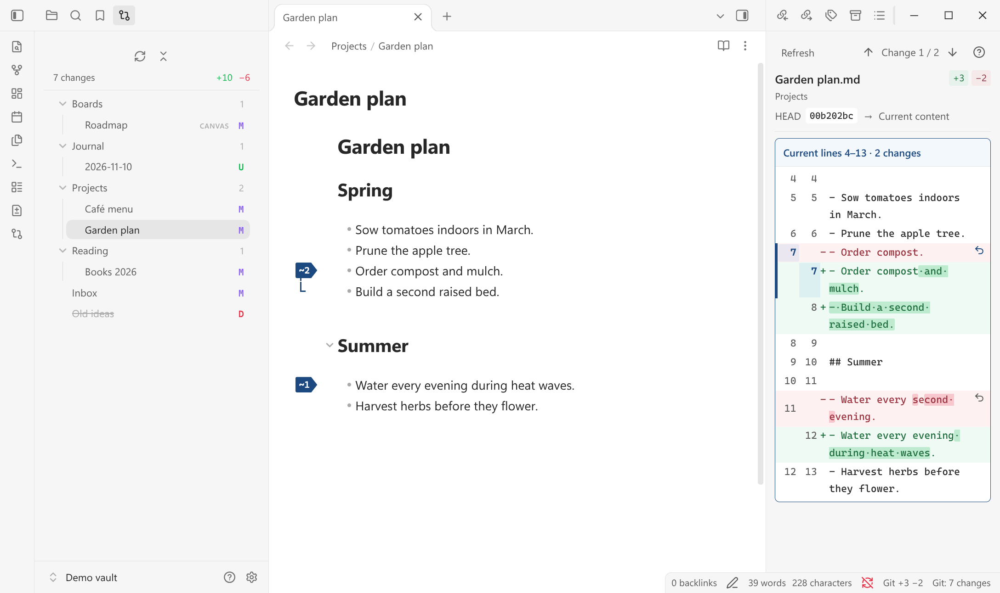
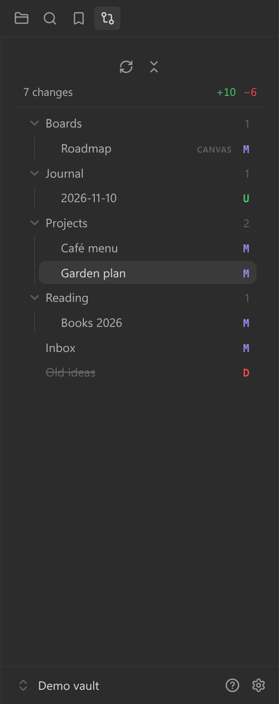

# Uncommitted

[](https://github.com/dingzy53/obsidian-uncommited/releases/latest)
[](https://github.com/dingzy53/obsidian-uncommited/releases)
[](https://obsidian.md)
[](LICENSE)
[](#requirements)

See every file in your vault that differs from the last Git commit, and review each change before you commit. Built on [Better MD Diff](https://github.com/kamacheng/better-md-diff) by kamacheng.




The **changes list** on the left shows every file that differs from `HEAD`, styled like the core file explorer.

## Features

- **Changes list** in the left sidebar: a folder tree of every file that differs from `HEAD`, styled and navigated like the core file explorer.
- **Status letters:** `A` added, `M` modified, `D` deleted, `R` renamed, `U` untracked, `!` conflict.
- **One summary:** `N changes +added −deleted` for the whole working tree.
- **Automatic refresh** on vault changes, window focus, or the refresh command. No timer polling.
- **Filters:** hide the config folder by default and add exclude patterns in settings.
- **Markdown diff:** open a changed note in the existing Better MD Diff panel, with per-change restore.
- **Plain diff:** canvas, PDF, image, audio, video, deleted, and other text files get a simple text or byte-size diff.
- **Discard:** return a file to `HEAD`, recreate a deleted file, or move an untracked file to the trash.
- **Read-only Git:** the plugin never stages, commits, or pushes.

The diff panel, editor flags, and per-change restore come from Better MD Diff. The changes list, status letters, and plain diff view are added here.

## Requirements

- Desktop **Obsidian 1.8.0+**
- A local **Git** installation
- A vault folder that is the root of its Git repository

## Installation

### From the community directory

Once the plugin is listed, open **Settings → Community plugins → Browse**, search for **Uncommitted**, then select **Install** and **Enable**.

### Manually

1. Download `main.js`, `manifest.json`, and `styles.css` from the [latest release](https://github.com/dingzy53/obsidian-uncommited/releases/latest).
2. Create `<vault>/.obsidian/plugins/uncommitted/` and put the three files there.
3. In Obsidian, disable **Better MD Diff** if it is enabled, then enable **Uncommitted** under **Settings → Community plugins**.

### From source

```bash
git clone https://github.com/dingzy53/obsidian-uncommited.git
cd obsidian-uncommited
npm ci
npm run build
OBSIDIAN_VAULT=/path/to/your/vault npm run install:vault
```

The install script stops if Better MD Diff is enabled.

> **Never enable both plugins.** Uncommitted keeps Better MD Diff's internal view type (`better-md-diff-view`), so Obsidian treats both plugins as registering the same view.

To keep the installed plugin out of your vault's Git history, add `.obsidian/plugins/uncommitted/` to the vault's `.gitignore`.

## Usage

Open the list with the **Git compare** ribbon icon, the **Open changes list** command, or the status bar item. It sits in the left sidebar next to the file explorer and uses the same tree styling, so it follows your theme.

Each row shows the file name without its extension, as the file explorer does. Non-Markdown files show their extension as a tag. A letter on the right gives the status: **A** added, **M** modified, **D** deleted (name struck through), **R** renamed, **U** untracked, **!** conflict. Folders show how many changed files they contain. Hover a row for its full path and line counts. The line under the toolbar sums up the whole list.



The list works from the keyboard: **Tab** moves into the tree, **↑**/**↓**, **Home** and **End** move between rows, **→** expands a folder or enters it, **←** collapses it or moves to its parent, and **Enter** or **Space** opens a file or toggles a folder. **Shift+F10** or the menu key opens the context menu.

Clicking a file:

| File | Result |
| --- | --- |
| Markdown that exists | Opens the note and the diff panel |
| Canvas, PDF, image, audio, video | Opens the file and a plain-text diff |
| Other text file | Opens only the plain-text diff |
| Deleted file | Plain diff only; binary files show their old and new sizes |

Right-click a row for **Show changes**, **Copy vault location**, and **Discard all changes**. The dialog names the file and the exact effect. Modified files return to `HEAD` in one editor transaction, so **Ctrl/Cmd+Z** undoes it, and staged changes stay staged. Deleted files are recreated. Added and untracked files go to Obsidian's trash. Renames and conflicts cannot be discarded here.

All commands are palette-only, with no default hotkeys:

- **Open changes list**
- **Refresh changes list**
- **Open next changed file** / **Open previous changed file**
- **Discard all changes in current file**
- **Compare the current document with HEAD**
- **Refresh Git diff**
- **Go to next change** / **Go to previous change**
- **Toggle editor diff markers**

### Settings

The settings tab has four short groups:

- **Appearance:** editor markers, diff font size, context lines, changed-text highlights, and changed whitespace.
- **Navigation:** whether the diff panel follows the editor, and the editor follows the panel.
- **Advanced:** refresh delay, Git polling interval, document size and line limits, and the Git executable.
- **Changes list:** untracked files, exclude patterns, and the status bar count.

## Privacy and security

- **Accounts and payment:** none. The plugin is free and needs no account.

- **Network use:** none. The plugin makes no requests and collects no telemetry.
- **Files outside the vault:** none. The plugin reads vault files, the vault's Git metadata, and its own `data.json`. The vault folder must be the repository root, so Git never reads above it.
- **`child_process`:** the plugin runs the local Git executable through `execFile` with `shell: false` and a read-only command set.
- **`fs`:** used only to resolve real paths before reading a Git baseline.
- **Clipboard:** the plugin never reads or writes the system clipboard. It only filters the text of a copy selection inside the diff panel.
- **Writes:** settings and the discard action are the only writes. Discard changes the working tree and may move a file to Obsidian's trash after confirmation.

## Limitations

- **Desktop only.** The plugin needs a local Git executable and a filesystem vault.
- **Repository root.** A vault inside a larger repository is rejected with an explanatory message.
- **No Git writes.** Staging, commits, pulls, and pushes are left to a terminal.
- **Not alongside Better MD Diff.** Both plugins register the same view, so enable only one.
- **No review workflow.** Better MD Diff's accepted-baseline review modules and GitLab comparison are not wired in.

## Development

Use Node.js 22.12+ or 24+ and npm:

```bash
npm ci
npm run check
npm run dev
```

`npm run check` runs ESLint with zero warnings, the test suite, strict TypeScript checking, the production build, and release validation. Tests use temporary Git repositories and a mocked Obsidian boundary.

To check the changes list against Obsidian's own tree styling, build first, then run the host check with Python Playwright and an Obsidian executable:

```bash
npm run build
python3 scripts/check-changes-native.py --executable /path/to/obsidian
```

It creates a throwaway vault and profile under `.test-vault/`, compares the computed row metrics with the core file explorer in the light and dark themes, and saves screenshots next to its report. It never opens your own vault.

New code lives in `src/changes/` and `tests/changes/`. Do not reformat or reorder upstream code; see [AGENTS.md](AGENTS.md) for the merge rules.

### Releasing

Use a tag that exactly matches `manifest.json`, without a `v` prefix. Pushing the tag runs [release.yml](.github/workflows/release.yml), which attests and publishes `main.js`, `manifest.json`, and `styles.css` on the GitHub release. The community directory reads `manifest.json` from the default branch and installs from the release with the matching tag.

## Credits

Uncommitted is a fork of [kamacheng/better-md-diff](https://github.com/kamacheng/better-md-diff). kamacheng wrote the diff panel, editor markers, and per-change restore, used here under the MIT license.

The demo uses the opening of Jane Austen's *Pride and Prejudice* (1813), public domain in the USA: [Project Gutenberg](https://www.gutenberg.org/ebooks/1342).

## License

[MIT](LICENSE) © 2026 Ding Zheng Yuan. The bundled `diff` dependency uses BSD-3-Clause; its license is included in the build.
